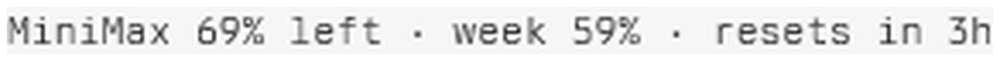
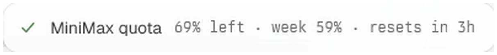

# tern-minimax-quota

A [Tern](https://stencil.so/tern) plugin that shows your **MiniMax Token Plan quota** in the terminal status line.

**The status line segment**, always present at the bottom of the window:



**Click it** and a toast reports the result:



- Auto-refreshes every **5 minutes**
- **Click the segment** to refresh on demand (a toast reports the result)
- Colour shifts green → yellow → red as the quota runs down
- Your API key lives in the **system keychain**, never in a file

Tern has no built-in quota display of any kind — this plugin fills that gap.

---

## Requirements

- Tern **0.9.2 or newer** (the plugin API, and `status_bar`, arrived in 0.9.2)
- A MiniMax **Token Plan** subscription and its API key
- Windows / macOS / Linux

## Install

```bash
tern plugin install https://github.com/meisijiya/tern-minimax-quota
```

`tern plugin install` copies the package into Tern's plugins directory
(`tern plugin dir`, `%APPDATA%\Tern\plugins` on Windows) and reloads. The
plugin then loads in **every** window, whatever directory that window was
opened in — Tern loads its plugins directory globally, not per project.

Confirm it took:

```bash
tern plugin list      # must end with "ready"
```

To remove it:

```bash
tern plugin remove minimax-quota
```

## Working on it

The repository is the source; Tern's plugins directory holds an **installed
copy**. They are two separate trees, and the copy is what actually runs. So a
change needs two steps:

```bash
# 1. edit the repository, then commit
git add -A && git commit -m "fix: ..."

# 2. push the change into Tern's plugins directory
tern plugin install "D:/path/to/tern-minimax-quota" --force
```

`--force` replaces an installed copy. Without it the command refuses to touch
one that is already there.

**Do not develop this with `tern plugin link`.** Linking runs the directory in
place instead of copying it, which makes it ambiguous which tree a running
window is using, and it records an absolute path that breaks the moment the
directory moves or the machine changes. Edit the repository, install the copy.

### 1. Restart Tern

`window_start` runs **once per plugin per window**, and `tern plugin reload` only
reloads the daemon — so a full restart of the Tern app is required. Until you do,
the palette commands will not appear.

### 2. Turn on the status bar

The status bar is **off by default** in Tern 0.9.2. The plugin's segment has
nowhere to render until you enable it:

- **Settings › General › Status bar** → on

or edit `%APPDATA%\Tern\settings.json` (`~/Library/Application Support/Tern/` on macOS):

```json
{ "status_bar": true }
```

Restart Tern after changing this.

### 3. Set your API key

Open the command palette and run **MiniMax Quota: Set API key**, then paste your key.

It is stored via `tern.secrets` in the OS keychain under the account
`plugin.minimax-quota.api_key`. Nothing is written to disk in plaintext.

As a fallback the plugin also reads `MINIMAX_CN_API_KEY` or `MINIMAX_API_KEY`
from Tern's environment.

## Usage

The segment is the whole interface:

| Action | Result |
|---|---|
| Read the segment | Current 5-hour and weekly remaining quota |
| Click the segment | Refresh now, with a toast confirming the outcome |
| Command palette → `MiniMax Quota: Refresh now` | Same, from the keyboard |
| Command palette → `MiniMax Quota: Set API key` | Change the stored key |

Clicking the segment and running `MiniMax Quota: Refresh now` from the palette do
the same thing and raise the same toast:


When the refresh cannot reach the API, the toast turns red and the segment states why
(`offline`, `HTTP <code>`, `bad reply`, `no key`).

### What the numbers mean

| Fragment | Meaning |
|---|---|
| `65% left` | Remaining quota in the **5-hour window** |
| `week 68%` | Remaining quota in the **weekly window** |
| `resets in 1h` | Time until the 5-hour window resets |

When MiniMax reports several model windows (`general`, `video`, …) the segment
shows the **tightest** one — that is the limit that actually gates you.

Colour thresholds, by remaining quota:

| Remaining | Tone |
|---|---|
| ≥ 30% | green (`success`) |
| 10–30% | yellow (`warning`) |
| < 10% | red (`error`) |

Error states replace the numbers with a short reason: `offline`, `HTTP <code>`,
`bad reply`, `no key — run 'Set API key'`, `no plan data`.

## Configuration

Edit `plugin.toml` and re-run `tern plugin reload`:

| Key | Meaning |
|---|---|
| `id` | Plugin identifier; must match the action name `plugin.<id>.<cmd>` |
| `name` / `description` | Shown in Settings › Plugins |
| `version` | Free-form |
| `icon` | A Tern (Material Design) icon name |
| `window` | The window-half Luau entry, relative to the plugin directory |
| `host` | Optional worker half, for background work with no UI |

The refresh interval and endpoint hosts are constants at the top of `main.luau`:

```lua
local API_CN = "https://api.minimaxi.com/v1/token_plan/remains"
local API_GLOBAL = "https://www.minimax.io/v1/token_plan/remains"
local REFRESH_MS = 5 * 60 * 1000
```

The plugin tries the CN host first and falls back to the global host on `401`/`403`,
so one key works in both regions.

## How it works

```
GET https://api.minimaxi.com/v1/token_plan/remains
Authorization: Bearer <your key>
Accept: application/json
```

Two details in that response are easy to get wrong, and this plugin handles both:

- **`current_interval_total_count` is usually `0`.** Most third-party guides treat it
  as the primary metric; the field that actually carries the quota is
  `current_interval_remaining_percent` (and `current_weekly_remaining_percent`).
- **`remains_time` is a duration, `end_time` is a wall-clock timestamp.** Tern's
  `tern.now()` is a *monotonic* clock, so the timestamp cannot be converted to a
  countdown without an epoch reference. The plugin uses `remains_time` and omits the
  countdown rather than showing a wrong one.

## Development

Editing this repository does not change the running plugin — Tern executes its
copy in the plugins directory. After any edit, install the copy again (see
[Working on it](#working-on-it)) and reload.

`tern.d.luau` is Tern's generated type declarations, for editor completion:

```bash
tern plugin types .
luau-lsp / your-editor-config   # point it at this directory
```

Regenerate it after upgrading Tern:

```bash
tern plugin types .
```

## Security notes

- The plugin runs with Tern's plugin permissions: it can read/write files, spawn
  processes, and make network requests. It does all three only to read one API
  endpoint and store your key in the keychain — review `main.luau`, it is ~250 lines.
- The key is never written to the plugin directory, and never sent anywhere except
  `api.minimaxi.com` / `minimax.io`.

## Uninstall

```bash
tern plugin remove minimax-quota
```

Your key stays in the OS keychain; delete it there if you want it gone.

## License

MIT
